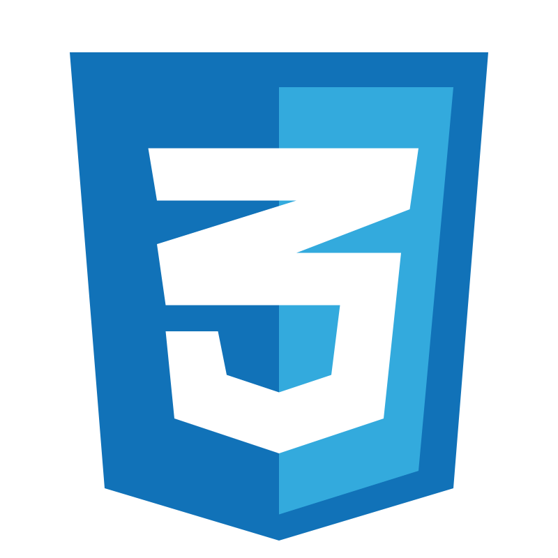
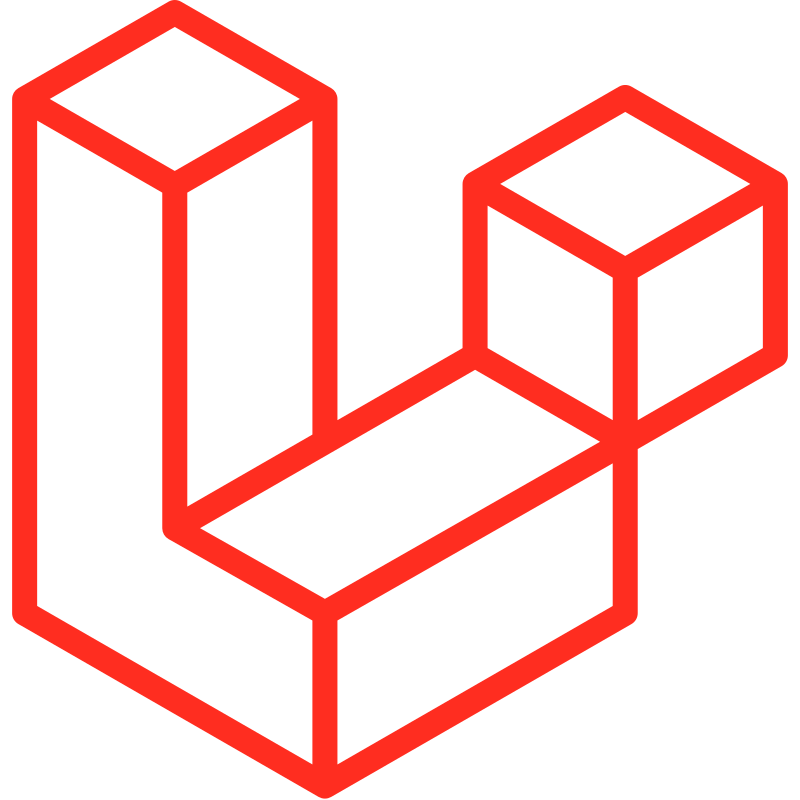
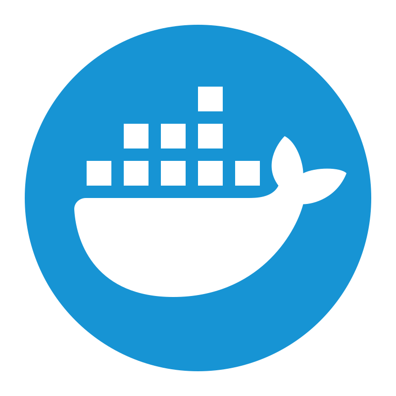
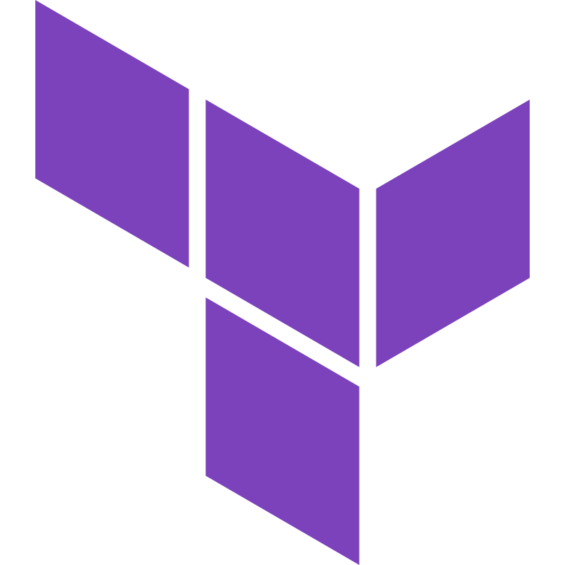
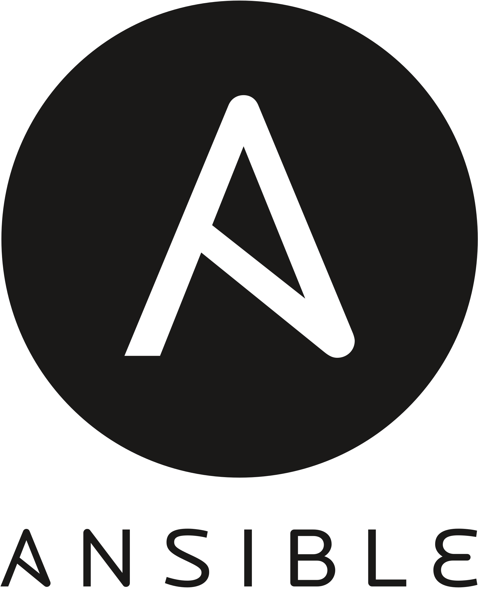
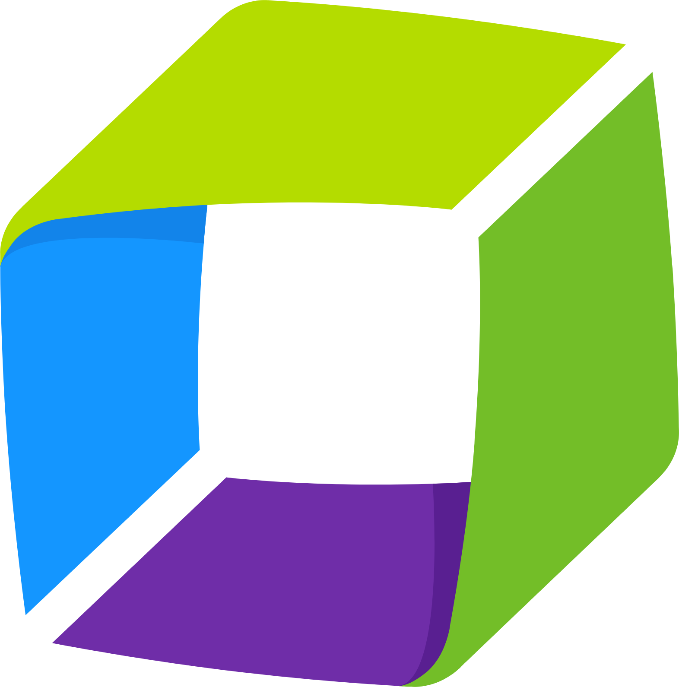

<h2 align="center">Hi there 👋! I'm Louay Khrouf ✨</h2>

  
  &nbsp;
  

 

### 👨‍💻 About Me

- ✨ My name is **Louay Khrouf**
- 🔭 **R&D Engineer** in the **Green IT** field at **Berger-Levrault**
- 🎓 **PhD Student** @ **INRIA Lille**
- 🎓 **INSAT Alumni**
- 🌱 **DevOps** and **Cybersecurity** enthusiast
- 👯 I'm currently working on **Web Development projects** and migrating them to the **Cloud**
- ✍️ I also share articles on [Medium](https://medium.com/@louay.khrouf)

 

---

### 📊 GitHub Stats

  
  

---

### 🛠️ Languages & Tools

  
  
  
  
  
  
  
  
  
  
  
  
  
  
  
  
  
  
  
  
  

 

  
  
  
  
  
  
  
  
  
  
  
  
  
  
  

 

  
  
  
  
  
  
  
  
  
  
  
  
  
  
  

---

### 🌐 How to Reach Me 😁

  
  
  
  
  

---

### 🐍 Contribution Snake

  

